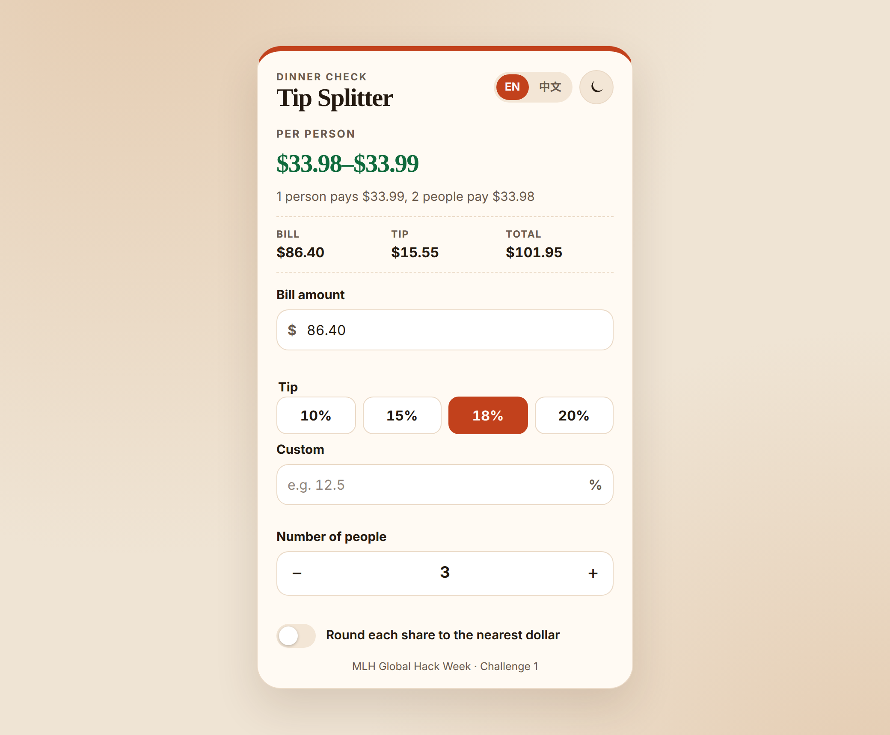
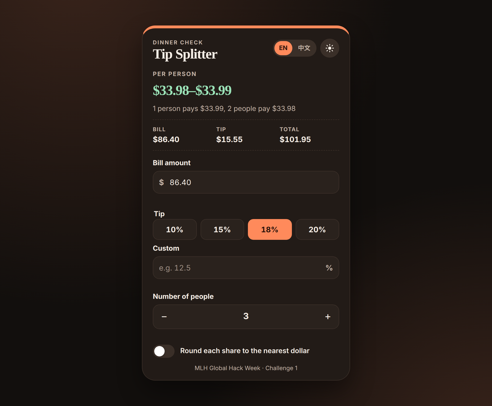

# Tip Splitter

A one-page bill splitter for MLH Global Hack Week, Challenge 1. Enter the bill, pick a tip, and say how many people are paying. The per-person amount, tip, and total update as you type.



## What it does

- Bill amount, tip percent, and number of people.
- Tip presets for 10%, 15%, 18%, and 20%, plus a custom percent.
- Live per-person amount, tip, and total. Leftover cents go one at a time to individual shares so the shares add up to the total.
- A rounding switch. Each share goes to the nearest dollar. When that would come up short, only as many people as needed pay one dollar more, and the table still covers the bill.
- Validation: amounts cannot be negative, and there is at least one person.
- Dark mode, saved in `localStorage` under `tip-splitter-theme`. Until you toggle it, the page follows your system theme.
- English and 中文, saved under `tip-splitter-lang`.

## Run it

Open `index.html` in a browser. The page is plain HTML, CSS, and JavaScript.

Links are relative (`style.css`, `calc.js`, `app.js`), so the same folder works on GitHub Pages: **Settings → Pages → Deploy from a branch → `main` → `/ (root)`**. `.nojekyll` is included so Pages serves every file as it is.

## Dark mode

Same sample check ($86.40, 18% tip, 3 people), after the theme toggle:



## Tests

```bash
node --test tests/app.test.mjs
```

`tests/app.test.mjs` loads the same `calc.js` the page uses. `node scripts/smoke.mjs` opens the page in headless Chrome, checks validation, presets, rounding, language, and dark mode, and rewrites the screenshots above.

## Built with Cursor

Built in Cursor for MLH Global Hack Week, Challenge 1. The page, the shared calculator, and the Node tests were written in Cursor, then run in headless Chrome. Bugs from that pass — a `file://` script that never loaded, a preset that left the custom tip in place, and rounding that added a dollar for every person — are written up in [DEVLOG.md](DEVLOG.md).
